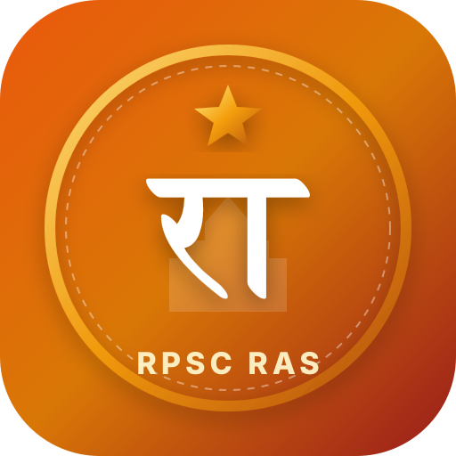

# RAS Yoddha | RPSC RAS Prelims Master & Gaming Arena 🏹

A complete, mobile-friendly **Progressive Web App (PWA)** and **Standalone Mobile App** for the **RPSC Rajasthan Administrative Service (RAS) Preliminary Examination**.



---

## 🌟 Key Features

1. **📊 Past Paper Analysis (2013 - 2023)**:
   - Official category-wise cutoffs (General, OBC, SC, ST).
   - Subject weightage breakdown (Rajasthan GK ~65+ Qs).
   - Top 10 High-Yield RPSC recurrence index.

2. **📝 Official Prelims Mock Simulator**:
   - Exact RPSC pattern: **150 Questions, 200 Marks, 180 Minutes**.
   - **$-1/3^{\text{rd}}$ ($-0.44$) Negative Marking** strictly calculated.
   - **Mandatory 5th Option Toggle** (*Option E: अनुत्तरित प्रश्न / Not Attempted* per latest RPSC mandate).
   - Mobile-first slide-up Question Palette drawer.
   - Comprehensive solution key with bilingual analysis.

3. **📚 Unlimited Subject-Wise Questions**:
   - Covers all 11 RPSC Prelims subjects.
   - Procedural & dynamic question generator creating infinite practice MCQs.
   - Instant solution feedback mode or exam drill mode.

4. **🧠 Smart Spaced Repetition (SRS)**:
   - *"Only important questions repeat"*: Low-yield trivia is never repeated once answered correctly.
   - Leitner 5-Box interval scheduler for $\ge 90\%$ high-yield concepts and incorrect questions.
   - Dedicated **Mistakes Notebook** for 1-click revision.

5. **🎮 Gamified Learning Arena (4 Rounds)**:
   - **⚡ 60-Sec Rapid Fire Blitz**: Fast streaks with $4\times$ combo multiplier.
   - **👑 Kaun Banega RAS Officer**: 10 ranks from Patwari to SDM with 50:50, Poll & Skip lifelines.
   - **⚔️ Cutoff Boss Battle**: Defeat the 1000 HP Cutoff Demon with critical hits.
   - **🗺️ Rajasthan 7 Divisions Conquest**: Conquer Jaipur, Jodhpur, Udaipur, Kota, Bikaner, Ajmer, Bharatpur.

---

## 📱 How to Push to Your GitHub & Run on Other Phones

### Step 1: Create a GitHub Repository
1. Go to [github.com/new](https://github.com/new) and name your repository (e.g. `ras-yoddha`).
2. Do **not** initialize with README or license.

### Step 2: Push Your Code
In your terminal, run:
```bash
git remote add origin https://github.com/<YOUR-USERNAME>/ras-yoddha.git
git branch -M main
git push -u origin main
```

---

## 🚀 Automated GitHub Actions (Included)

Once you push to GitHub, two workflows run automatically:

1. **GitHub Pages Deployment (`deploy-pages.yml`)**:
   - Automatically builds and deploys your standalone app to:
     `https://<YOUR-USERNAME>.github.io/ras-yoddha/`
   - *Enable in GitHub Settings $\to$ Pages $\to$ Source: "GitHub Actions"*.
   - Any phone in the world can open this link and tap **"Install App"** to run it 100% offline!

2. **Android APK Compilation (`build-apk.yml`)**:
   - Compiles an Android `.apk` file using Capacitor and Android SDK.
   - Go to your GitHub repository $\to$ **Actions** tab $\to$ Download `RAS-Yoddha-Android-APK`.
